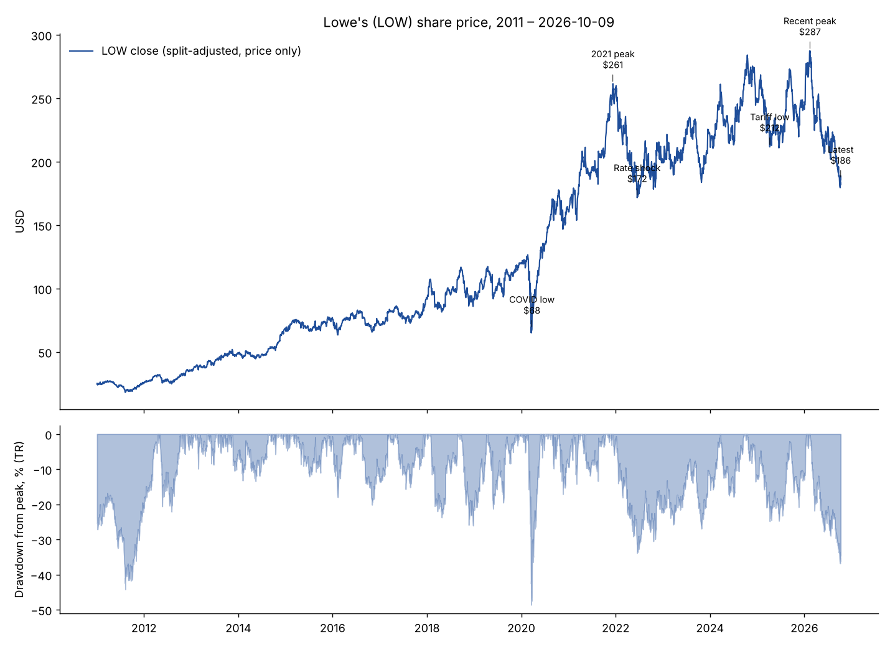
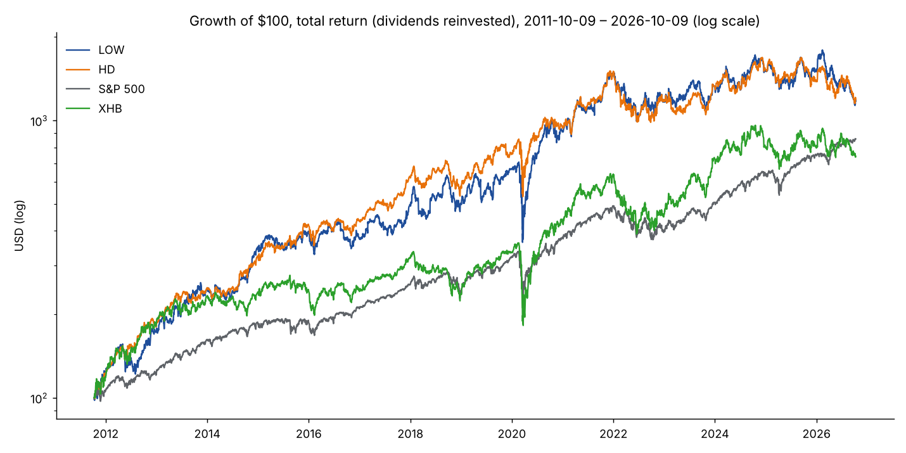
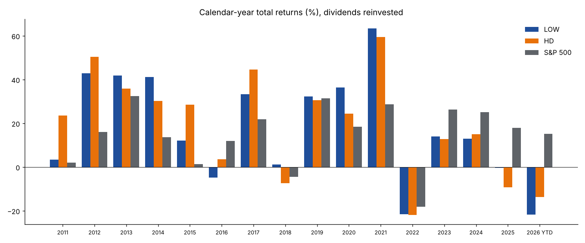
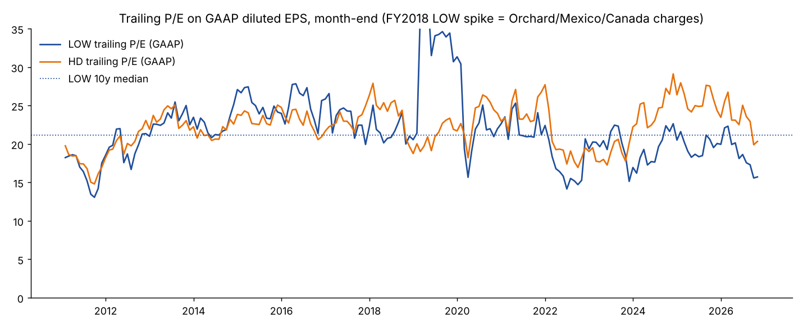
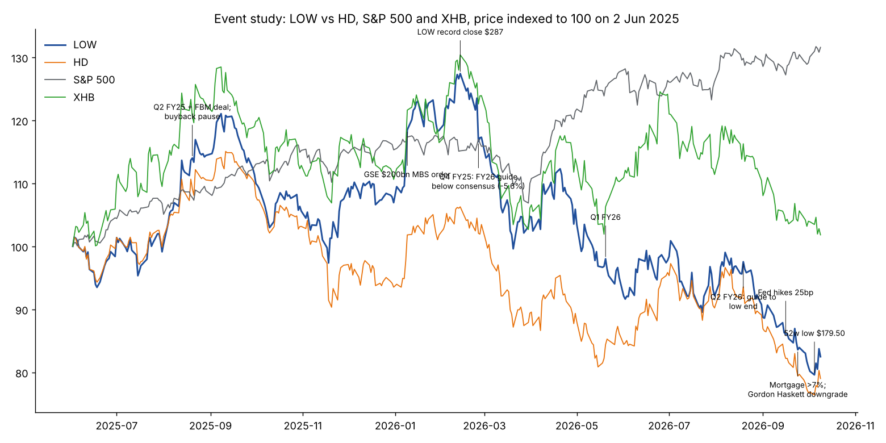
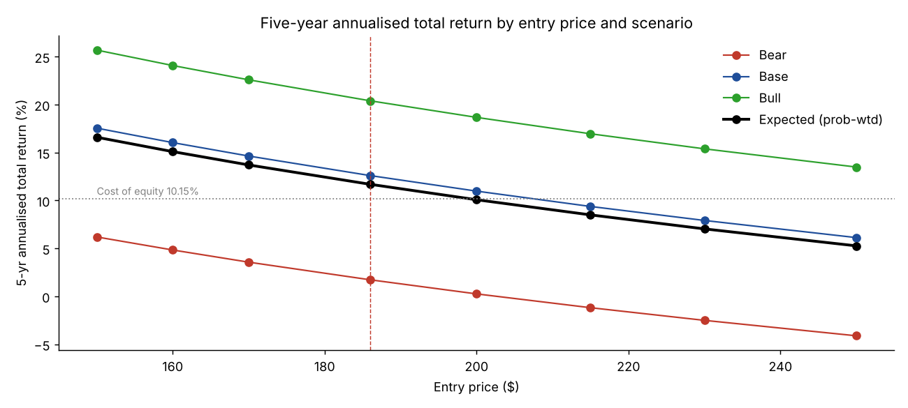
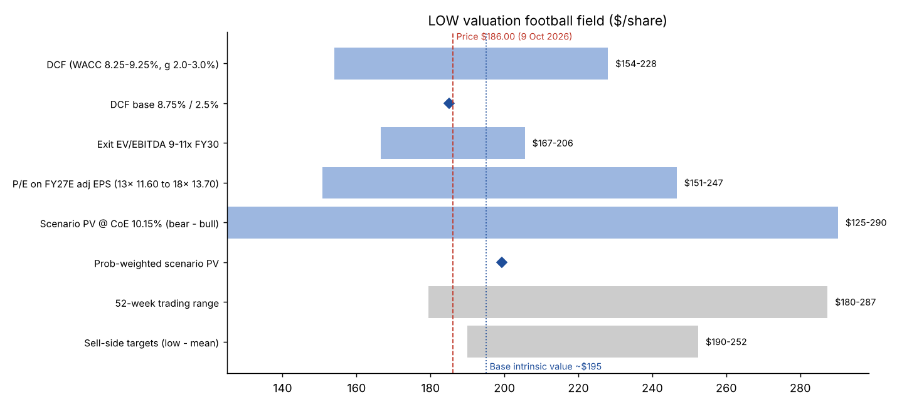

# Lowe's Companies, Inc. (NYSE: LOW): Investment Memorandum

| Item | Value |
|---|---|
| Research cutoff | **11 Oct 2026** |
| Share price | **$186.00**, NYSE close **Fri 9 Oct 2026** (Yahoo Finance daily series, pulled 11 Oct 2026) |
| Latest reported period | **Q2 FY2026**, quarter ended 31 Jul 2026 (8-K 19 Aug 2026; 10-Q filed 27 Aug 2026) |
| Fiscal year | Lowe's FY2026 ends 29 Jan 2027. "FY25" is the year ended 30 Jan 2026. |
| Macro data | Latest official prints as of 8–10 Oct 2026 (Freddie Mac PMMS 8 Oct; 10-yr UST 8 Oct; NAR August; Census August) |

Labels used throughout: **[F]** reported fact · **[G]** company guidance · **[C]** third-party consensus or forecast · **[M]** my model or assumption.

Everything in this memo can be regenerated from the scripts in this folder (see §9).

---

## 1. Executive memorandum

### Recommendation: **WATCHLIST**. Do not initiate at $186. Start a position at ≤ $170 (or on evidence of better fundamentals); full position at ≤ $150. Confidence: moderate (~60%).

**Price and valuation at $186.00**

| Metric | Value |
|---|---|
| Market cap | $104.4bn (561.1m shares [F]) |
| Net debt | $34.2bn [F]. Excludes $4.8bn of operating leases. |
| Enterprise value | $138.5bn |
| P/E on FY26 adjusted EPS guide of $12.25 [G] | 15.2x |
| P/E on FY27 consensus of $13.00 [C] | 14.3x |
| Trailing GAAP P/E | 15.7x |
| EV / TTM EBITDA | 10.9x |
| TTM FCF yield | 6.7% |
| Dividend yield | 2.7% |

**The bottom line**

- **Lowe's is cheap against its own history but not against the risk-free rate.**
  - The trailing P/E is at the bottom of its 10-year range (14.2x–24x, median 21x).
  - The 10-year Treasury is now 5.22%, versus about 2.5% on average over that decade.
  - The earnings yield is 6.4%, only about 1.2 points above Treasuries. At the June 2022 trough the gap was about 4 points.
- **My base-case intrinsic value is about $195**, roughly 5% upside.
- **The probability-weighted 5-year expected return is about 11–12% a year**, against a cost of equity of about 10%.
- That is a fair return, not a margin of safety. It also comes with a deteriorating macro backdrop:
  - The Fed hiked on 16 Sep 2026.
  - The 30-year mortgage rate is 7.40%.
  - The Harvard remodeling indicator projects only +0.5% growth by Q2 2027.
  - Leverage is 3.0x, and buybacks are paused until about mid-2027.

**Three strongest arguments for the stock**

1. **The de-rating is mostly multiple, not earnings.**
   - From the record close ($287.39, 13 Feb 2026), about 88% of the 35% fall is P/E compression, from 22.2x to 15.1x forward.
   - Only about 12% comes from FY26 EPS estimate cuts (~$12.95 to $12.31).
   - Earnings power has not broken: comps are positive (+0.2% to +1.3%) and the adjusted operating margin is about 11.6% even at a cyclical low.
2. **The cash generation is high quality.**
   - Normalized FCF is about $7.0bn, or roughly $12.5 per share (FY23–25 average $7.2bn; TTM $7.0bn).
   - FCF exceeded net income in FY24 and FY25.
   - Dividend payout is about 40% of FCF, and the dividend has been raised for 50+ consecutive years.
3. **There is a cyclical recovery option attached.**
   - The median US home is 42 years old.
   - About half of mortgages carry rates below 4%, so turnover is suppressed rather than lost.
   - When turnover normalizes, my bull case (18–19x on about $23 of EPS) implies roughly 20% a year.

**Three strongest arguments against**

1. **The macro is getting worse, not better.**
   - The Fed hiked to 3.75–4.00% and the dot plot shows one more hike.
   - The 10-year yield rose from 4.04% to 5.22% since the February peak, and mortgage rates from 6.09% to 7.40%.
   - Existing-home sales are 3.98m SAAR.
   - Consumer sentiment is 46.3 and Conference Board confidence is at its lowest since 2014.
   - The Q3 FY26 guide implies adjusted EPS about 7% lower year on year [G].
2. **Lowe's is weaker than Home Depot, and its balance sheet has less room.**
   - Lowe's comps have trailed HD's for most quarters since 2022.
   - Lowe's paid 13.4x EBITDA for FBM. That pushed lease-adjusted leverage to 3.0x and halted buybacks, which were historically about a third of EPS growth.
   - Year to date LOW is down 22.9%, against −15.5% for HD.
3. **Historical EPS growth relied on debt-funded buybacks, and that model has run its course.**
   - From FY15 to FY25, EPS grew 15.8% a year. Net income grew only 10.1% a year; share count reduction contributed 5.2% a year.
   - Net debt rose from $12bn to $39bn, and equity is negative.
   - From FY21 to FY25, net income fell 5.8% a year and EPS was flat.
   - The FY21–22 buybacks were done at about $226 a share, above today's price.

**Valuation summary [M]**

| Approach | Value per share |
|---|---|
| DCF (WACC 8.75%, terminal growth 2.5%) | **$185** (range $154–228) |
| Exit EV/EBITDA cross-check | $167–206 |
| FY27 EPS × P/E | $151 / $205 / $247 |
| Scenario PV at a 10.15% cost of equity | $125 / $208 / $290 |
| **Triangulated base intrinsic value** | **≈ $195** |
| Bear value | ≈ $125–150 |
| Bull value | ≈ $250–290 |

**Expected 5-year total return from $186 [M]**

| Scenario | Probability | Annualized return |
|---|---|---|
| Bear | 30% | +1.7% |
| Base | 50% | +12.6% |
| Bull | 20% | +20.4% |
| **Probability-weighted** | | **≈ 11–12%** |
| Stress (not weighted) | | −3.7% (−17% cumulative) |

Dividends contribute about 3 points a year of the base-case return.

**What would invalidate the thesis (in either direction)**

- **Negative:**
  - Comps of −2% or worse for two consecutive quarters together with gross margin erosion beyond the FBM mix effect.
  - Lease-adjusted leverage above 3.25x, or the buyback restart pushed beyond FY27.
  - FBM integration problems, such as goodwill impairment or margin dilution beyond about 40bp.
- **Positive:**
  - Mortgage rates below about 6.25% *for reasons other than recession*, together with existing-home sales above 4.5m.
  - Lowe's comps closing the gap to HD.
  - A credible Dec 9, 2026 investor-day plan that combines margin expansion with an earlier buyback restart.

**Main sources of uncertainty**

- The exit multiple, which depends on where long rates settle.
- Timing of the housing-turnover recovery.
- Whether FBM/ADG (Pro distribution) creates value at the price paid.

---

## 2. Historical stock and total-return analysis





### 2A. Compound returns to 9 Oct 2026 [F, computed]

TR = total return with dividends reinvested, from Yahoo adjusted closes. The S&P 500 TR column uses the ^SP500TR index.

| CAGR | LOW price | LOW TR | HD TR | S&P 500 TR | XHB TR (homebuilders/home improvement ETF) |
|---|---|---|---|---|---|
| 1 yr | −20.7% | −19.1% | −20.8% | +17.3% | −9.0% |
| 3 yr | −2.5% | −0.5% | +2.1% | +23.3% | +8.7% |
| 5 yr | −2.0% | **−0.1%** | −0.3% | +13.8% | +6.5% |
| 10 yr | +10.1% | **+12.1%** | +11.2% | +15.6% | +12.0% |
| 15 yr | +15.9% | **+18.0%** | +18.1% | +15.7% | +14.6% |

| Risk statistic | LOW | HD | S&P 500 TR |
|---|---|---|---|
| 10-yr annualized volatility (daily) | 29.4% | 25.2% | 18.1% |
| 10-yr return/volatility | 0.42 | 0.45 | 0.86 |
| 10-yr max drawdown (TR) | −48.6% (Feb–Mar 2020) | −38.0% | −33.8% |
| 10-yr beta vs S&P 500 (weekly) | 1.19 | 1.07 | 1.00 |
| Current drawdown from peak (TR) | **−36.9%** (13 Feb 2026 to 5 Oct 2026 low) | — | — |

**Dividends**
- Dividends added about 2.0 points a year to LOW's 10-year return (12.1% TR vs 10.1% price).
- Dividends paid per share grew from $1.02 (CY2015) to $4.70 (CY2025), a 16.5% CAGR.
- Recent raises have slowed to about 4% a year: $1.15, then $1.20, then $1.25 quarterly.

**Peak-to-trough declines above 20% (TR):**

| Period | Decline | Context |
|---|---|---|
| 2007–09 | −61% | Housing bust |
| 2018 | −24% and −26% | |
| 2020 | −49% | COVID |
| Dec 2021 – Jun 2022 | −34% | Took until Mar 2024 to recover |
| Oct 2024 – Apr 2025 | −25% | Tariff shock |
| **Feb 2026 – Oct 2026** | **−37%** | Current |

Annual returns are in `output/annual_returns.csv` and charted above. Selected years:

| Year | LOW TR | HD TR | S&P 500 TR |
|---|---|---|---|
| 2020 | +36% | +25% | +18% |
| 2021 | +63% | +60% | +29% |
| 2022 | −21% | −22% | −18% |
| 2023 | +14% | +13% | +26% |
| 2024 | +13% | +15% | +25% |
| 2025 | −0.3% | −9% | +18% |
| 2026 YTD | **−21.7%** | −13.7% | +15.1% |

### 2B. Regimes and comparability

| Period | What drove it | Comparable to today? |
|---|---|---|
| 2012–2017: margin catch-up rally (LOW +40% a year in 2012–14) | Housing recovery after the GFC; low rates; LOW closing its margin gap to HD | Partly. That rally started from depressed margins; today's margin is near the historic norm. |
| 2018: housing slowdown plus rate rise (10-yr to 3.2%) | CEO change (Ellison); Canada/Orchard write-downs | **Yes**: rate-driven housing slowdown, multiple compression. |
| 2020–21: pandemic boom | Comps +26%; EPS from $5.74 to $12.04 (adjusted) | **No.** It was a one-off demand pull-forward. FY21 margins and EPS are not a base to extrapolate. |
| 2022–23: inflation and rate shock | Mortgage rates 3% to 7%; P/E trough 14.2x (Jun 2022) with the 10-yr near 3% | **Most comparable**, but rates are now about 2 points higher. |
| 2023–25: housing freeze | Existing sales about 4.06m in both 2024 and 2025 (lowest since 1995); comps −4.7% and −2.7%; stock re-rated to about 22x anyway | Similar fundamentals, but valuation was supported by expected rate cuts that have now reversed. |
| 2026: rate re-acceleration | 10-yr from 4.0% to 5.2%; Fed hike | Today. |

**Not comparable: 2006–2011.** That episode combined a credit and home-price collapse. Today home prices are still +1.9% y/y (Case-Shiller, Jul 2026), owners hold large equity, and lending is tight. The risk today is stagnation rather than collapse.



---

## 3. Why is the stock down? Event study



**Price path [F]**

| Point | Date | Price | Change |
|---|---|---|---|
| Start of 2026 | 31 Dec 2025 | $241.16 | |
| Record | 13 Feb 2026 | $287.39 close ($293.06 intraday high, 12 Feb) | |
| 52-week low | 5 Oct 2026 | $179.50 close ($178.45 intraday) | |
| Latest | 9 Oct 2026 | **$186.00** | −35.3% from peak; −22.9% YTD |

Over the same peak-to-latest window: HD −25.7%, XHB −21.9%, S&P 500 +14.3%.

### 3A. Attribution [M, computed]

**1. Multiple versus earnings.**
- ln(186/287.39) = −43.5 log points.
- FY26 consensus EPS fell from about $12.95 (pre-25 Feb 2026, Benzinga) to $12.31 (Yahoo, Oct 2026). That is −5.1 log points, about **12%** of the decline.
- Forward P/E compressed from 22.2x to 15.1x, −38.4 log points, about **88%** of the decline.

**2. Sector/macro versus company-specific.**
- LOW's beta to HD was 0.91 (daily, Oct 2024 – Feb 2026).
- HD's fall explains about −27 log points (**~62%**). The remaining −16 log points (**~38%**) is specific to LOW.
- The LOW-specific part is concentrated between 13 Feb and 18 Aug 2026: LOW −25.0% vs HD −13.7%.
- Since 18 Aug, the two have fallen together (−13.7% vs −13.9%) as the 10-yr rose from 4.71% to 5.22% and mortgage rates from 6.67% to 7.40%.

**3. Rates.**
- Since the peak, the 10-yr is up 118bp and the 30-yr mortgage is up 131bp.
- LOW's earnings yield rose from about 4.5% to 6.6%, about 210bp.
- So roughly 55–60% of the multiple compression matches the rise in risk-free rates. The remainder reflects a wider risk premium on housing-linked equities.
- This is a correlation-based attribution. It does not prove causation.

### 3B. Chronology

| Date | Event | Expected or surprise? | Fundamental effect | Nature | Reaction proportionate? |
|---|---|---|---|---|---|
| 20 Aug 2025 | FBM deal at $8.8bn (13.4x EBITDA; 2024 revenue $6.5bn); buybacks paused until about Q2 2027 [F] | Surprise | Adjusted-EPS accretive in year 1 but GAAP-dilutive; ~40bp margin-mix dilution; leverage to ~3.1x; loses ~$4bn a year of buybacks | Structural (strategy) | Stock +0.3%, then rallied. The market under-reacted at first and the gap opened later as Pro/DIY performance diverged. |
| 9 Jan 2026 | Order for GSEs to buy $200bn of MBS; mortgage rates fell toward 6% | Surprise | Sentiment-driven; no direct EPS effect | Policy | LOW +4.3% in a day, part of a +19% run to the peak. Over-reaction in hindsight. |
| 20 Feb 2026 | Supreme Court strikes down IEEPA tariffs (6–3) | Partly expected | Lower cost of goods; refunds ($80m booked in Q2 FY26 = $0.11 EPS) | Temporary one-off | Muted |
| **25 Feb 2026** | Q4 FY25: comp +1.3% (vs ~0.5% expected), adjusted EPS $1.98 beat. FY26 adjusted EPS guide **$12.25–12.75 vs $12.95 consensus**; GAAP margin 11.2–11.4% [F/G] | Surprise on guide | ~−4% to FY26 EPS expectations | Mostly acquisition mix plus interest cost | **−5.6% on the day.** Proportionate to the EPS reset, given 22x. |
| Mar–May 2026 | Rates rose; FOMC on hold, hawkish dissents in July | Partly expected | Multiple | Cyclical | LOW −25% from the peak by end-May, versus HD −17% |
| 20 May 2026 | Q1 FY26: comp +0.6%, adjusted EPS $3.03 beat ($2.97); gross margin −70bp from acquired businesses; guide affirmed | Small beat | Neutral | — | +1.2% |
| **19 Aug 2026** | Q2 FY26: comp +0.2% (transactions −2.1%, ticket +2.3%); adjusted EPS $4.40 incl. $0.11 refund (beat $4.22 even ex-refund); revenue miss ($25.96bn vs $26.13bn); **guide moved to the bottom**: sales $92.0bn, comp flat, adjusted EPS ~$12.25, GAAP ~$11.75; Q3 adjusted EPS about 7% lower y/y [F/G] | Mild negative | FY26 EPS −1% to −2% vs consensus; "persistent DIY pressure" | Cyclical | +2.0% (−3% premarket). Proportionate. |
| 16 Sep 2026 | **Fed hikes 25bp** to 3.75–4.00% (12–0); dot plot implies one more hike [F] | Largely priced (July dissents) | Higher rates, weaker housing turnover, multiple | Cyclical | LOW −9% in September, HD −13%: **sector-wide** |
| 24 Sep 2026 | Mortgage rates back above 7%; Gordon Haskett downgrade to Hold (target $200) | — | — | — | Sentiment |
| 5 Oct 2026 | 52-week low of $179.50; Evercore target cut to $190 (secondary source) | — | — | — | — |

**What is *not* in the decline**
- There has been no guidance collapse: FY26 adjusted EPS is down only about 4% from initial expectations.
- There has been no credit event and no dividend risk.
- The market is pricing a **longer, higher-rate housing freeze**, not a broken company.

**What may still be under-priced**
- FY27 consensus of $13.00 (+5.6%) assumes a recovery that the macro data does not yet support. My base is $12.55.

---

## 4. Business quality and competitive position

**Business model and revenue mix [F]**

| Item | Detail |
|---|---|
| Stores | ~1,750 US home-improvement stores |
| Retail Home Improvement segment, Q2 FY26 | $24.0bn of $26.0bn sales |
| "Other" segment (FBM + ADG Pro distribution/installation) | $1.94bn in Q2 FY26 (vs $0.14bn a year earlier); ~$7.5bn annualized |
| Categories | 13 categories. Q2 strength: rough plumbing, electrical, tools, appliances |
| Online | +15.7% y/y; adds ~195bp to comp |
| Sourcing | ~40% of cost of goods sourced outside the US |

**Customer mix**
- DIY is about 70% of sales; Pro was about 30% in 2025, up from about 19% in 2019 [F, FBM deal deck].
- HD's Pro share is "nearly half" (secondary source).
- **This mix is Lowe's core weakness:** DIY is the segment most exposed to housing turnover and discretionary projects.

**Strategy ("Total Home"; FBM/ADG)**
- FBM extends Lowe's into large-Pro distribution, a ~$250bn addressable market per the company.
- This copies HD's SRS/GMS strategy roughly 15–18 months later.
- Ellison's productivity program raised the operating margin from 8.75% (FY19) to 13.4% (FY23). That was real execution, and part of it was catch-up to HD.

**Industry structure**
- Home improvement spending is about $517bn a year for owner improvement and repair (JCHS LIRA, Q2 2026). HD defines a broader ~$1.1–1.2tn total addressable market including Pro.
- Big-box retail is a **duopoly**. Menards (private, regional), Floor & Decor and Amazon compete at the edges.
- Gross margins have stayed at 32–35% for a decade despite e-commerce. That is evidence of real pricing discipline and scale purchasing.

**Moat: narrow, stable, not widening.** Sources of advantage:
- Purchasing scale.
- A dense store and distribution network, so bulky, heavy goods are expensive for online rivals to deliver.
- Supplier exclusives and a duopoly that has not fought on price.

The advantage is **relative**: HD is larger (1.9x sales), has the stronger Pro franchise, and has posted better comps since 2022. Returns on the legacy retail asset base are well above the cost of capital. Standard ROIC is distorted by negative book equity, so I do not quote a figure. The acquisitions are a different matter: FBM's purchase price implies a 7.2% pre-tax EBITDA yield ($635m / $8.8bn), or roughly 5% after D&A and tax. That is **below my 8.75% WACC** until growth and synergies arrive, so FBM dilutes returns. The brand is not the moat; the logistics network and duopoly structure are.

**Cyclicality**
- Comps ran −4.7% and −2.7% in FY23–24 with turnover at 30-year lows. That was a soft cycle, not a crash.
- Big-ticket discretionary categories (kitchens, flooring) are cyclical. Repair and maintenance is about 50–60% of demand and defensive.

### Lowe's vs Home Depot (latest data; HD from its 8-Ks and 10-Q)

| | LOW | HD |
|---|---|---|
| Price (9 Oct 2026) | $186.00 | $290.74 |
| Market cap / EV | $104bn / $138bn | $290bn / $341bn |
| FY26 adjusted EPS (guide / consensus) | $12.25 [G] / $12.31 [C] | $14.69–15.28 [G] / $15.02 [C] |
| Forward P/E (FY26 / FY27 consensus) | 15.1x / 14.3x | 19.4x / 18.2x |
| FY27 EPS growth (consensus) | +5.6% | +6.5% |
| EV / TTM EBITDA | 10.9x | 13.8x |
| TTM FCF yield | 6.7% | 5.2% |
| Dividend yield / payout of adjusted EPS | 2.7% / 41% | 3.2% / 62% |
| FY26 sales growth guide (organic comp) | +6.6% (comp flat) | +2.5–4.5% (comp flat to +2%) |
| Q2 FY26 comp / transactions | +0.2% / −2.1% | +1.7% / −1.0% |
| FY26 GAAP operating margin guide | 11.2% | 12.4–12.6% |
| Net debt / EBITDA (excl. leases) | 2.7x (3.0x lease-adjusted [F]) | 2.1x |
| Buybacks | Paused until about Q2 FY27 (but $0.36bn in Q1 FY26) | Paused since Mar 2024; resume ~mid-FY27 (secondary source) |
| TTM P/E: 5-yr median gap | LOW −4.4x below HD | — |
| TTM P/E: current gap | LOW −4.6x below HD | — |

**Read-across**
- The LOW discount to HD is **normal**, not anomalous: −4.6x now versus a 5-year median of −4.4x.
- It is justified by weaker comps, lower Pro mix, a lower margin and higher leverage.
- **Lowe's is not "cheap relative to HD."** Both stocks are cheaper than their own histories because of rates.

---

## 5. Historical financial performance

Source: SEC XBRL 10-K data. Adjusted EPS and comps are from Lowe's Q4 releases. All figures are GAAP unless labelled.

| FY | Revenue ($m) | Growth | Comp | Gross margin | Op margin | Net income | GAAP EPS | Adj EPS | Diluted shares (m) |
|---|---|---|---|---|---|---|---|---|---|
| 2015 | 59,074 | 5.1% | 4.8% | 34.8% | 8.4% | 2,546 | 2.73 | 3.29 | 929 |
| 2016* | 65,017 | 10.1% | 4.2% | 34.6% | 9.0% | 3,091 | 3.47 | 3.99 | 881 |
| 2017 | 68,619 | 5.5% | 4.0% | 34.1% | 9.6% | 3,447 | 4.09 | 4.39 | 840 |
| 2018 | 71,309 | 3.9% | 2.4% | 32.1% | 5.6% | 2,314 | 2.84 | ~5.10 (unverified) | 812 |
| 2019 | 72,148 | 1.2% | 2.6% | 31.8% | 8.8% | 4,281 | 5.49 | 5.74 | 778 |
| 2020 | 89,597 | 24.2% | 26.1% | 33.0% | 10.8% | 5,835 | 7.75 | 8.86 | 750 |
| 2021 | 96,250 | 7.4% | 6.9% | 33.3% | 12.6% | 8,442 | 12.04 | 12.04 | 699 |
| 2022* | 97,059 | 0.8% | −0.9% | 33.2% | 10.5% | 6,437 | 10.17 | 13.81 | 631 |
| 2023 | 86,377 | −11.0% | −4.7% | 33.4% | 13.4% | 7,726 | 13.20 | 13.09 | 584 |
| 2024 | 83,674 | −3.1% | −2.7% | 33.3% | 12.5% | 6,957 | 12.23 | 11.99 | 568 |
| 2025 | 86,286 | 3.1% | 0.2% | 33.5% | 11.8% | 6,654 | 11.85 | 12.28 | 560 |
| TTM Q2 FY26 | 90,431 | — | — | 33.3% | 11.4% | 6,642 | 11.83 | ~12.3 | 560 |

\* 53-week year. FY23 revenue reflects the exit from Canada retail (sold Feb 2023).

**Main GAAP-to-adjusted items**

| FY | Item | EPS effect |
|---|---|---|
| FY15 | Australia JV impairment | +$0.56 |
| FY18 | Canada goodwill, Orchard, Mexico, store closures | ~$2.2bn pre-tax |
| FY20 | Debt extinguishment | +$1.05 |
| FY22 | Canada retail sale loss | +$3.64 |
| FY23–24 | Canada consideration gains | −$0.11 / −$0.24 |
| FY25 | FBM/ADG costs + amortization ($321m pre-tax) | +$0.43 |
| FY26 onward | Lowe's excludes acquired-intangible amortization ($397m FY26; $329m a year FY27–29) | ~+$0.50 |

| FY | CFO | Capex | FCF | FCF / NI | Dividends | Buybacks | Acquisitions | Total debt | Cash | Net debt | ND/EBITDA |
|---|---|---|---|---|---|---|---|---|---|---|---|
| 2016 | 5,617 | 1,167 | 4,450 | 1.44 | 1,121 | 3,595 | 2,356 | 15,699 | 558 | 15,041 | 2.0x |
| 2017 | 5,065 | 1,123 | 3,942 | 1.14 | 1,288 | 3,192 | 509 | 16,995 | 588 | 16,305 | 2.0x |
| 2018 | 6,193 | 1,174 | 5,019 | 2.17 | 1,455 | 3,037 | 0 | 16,223 | 511 | 15,494 | 2.8x |
| 2019 | 4,296 | 1,484 | 2,812 | 0.66 | 1,618 | 4,313 | 0 | 19,306 | 716 | 18,430 | 2.4x |
| 2020 | 11,049 | 1,791 | 9,258 | 1.59 | 1,704 | 4,971 | 0 | 21,780 | 4,690 | 16,584 | 1.5x |
| 2021 | 10,113 | 1,853 | 8,260 | 0.98 | 1,984 | 13,012 | 0 | 24,727 | 1,133 | 23,323 | 1.7x |
| 2022 | 8,589 | 1,829 | 6,760 | 1.05 | 2,370 | 14,124 | 0 | 33,960 | 1,348 | 32,228 | 2.7x |
| 2023 | 8,140 | 1,964 | 6,176 | 0.80 | 2,531 | 6,138 | 0 | 35,921 | 921 | 34,693 | 2.6x |
| 2024 | 9,625 | 1,927 | 7,698 | 1.11 | 2,566 | 4,053 | 0 | 35,487 | 1,761 | 33,354 | 2.7x |
| 2025 | 9,864 | 2,213 | 7,651 | 1.15 | 2,636 | 211 | 10,088 | 39,921 | 982 | 38,569 | 3.1x |
| TTM | 9,263 | 2,263 | 7,000 | 1.05 | ~2,700 | ~470 | — | 37,556 | 3,407 | 34,149 | 2.7x |

Debt includes finance leases; net debt also deducts short-term investments. FY25 ND/EBITDA uses only one quarter of FBM EBITDA.

### What changed and why

**EPS growth came largely from buybacks**

| Period | EPS | Net income | Share reduction |
|---|---|---|---|
| FY15–25 | ×4.34 (+15.8%/yr) | +10.1%/yr | +5.2%/yr |
| FY21–25 | **−0.4%/yr** | **−5.8%/yr** | +5.7%/yr |

- Over a decade, about one third of EPS growth came from share reduction. Since the 2021 peak, all of it has.
- The buybacks were **debt-funded**: net debt went from $15bn to $34–39bn while equity turned negative (−$9.9bn at FY25).
- The re-levering is largely done (mgmt target 2.75x lease-adjusted), so future buybacks are limited to roughly FCF minus dividends, plus debt that grows with EBITDA.

**Margins**
- Operating margin moved from 8.8% (FY19) to 13.4% (FY23), driven by productivity, mix and pandemic operating leverage, then fell to 11.2% (FY26 GAAP guide).
- The FY26 decline comes from three sources:
  - FBM/ADG mix: about −40bp of gross margin, from lower-margin distribution.
  - Amortization: −40bp.
  - Deleverage on flat comps.
- The retail-only margin is roughly 12%+. A sustainable through-cycle GAAP margin is **11.5–12.5%**. The FY23 13.4% included pandemic-era pricing.

**Earnings quality is good**
- FCF/NI averaged 1.1x over FY22–25.
- Working capital is structurally light: inventory of $17.3bn is largely funded by payables.
- Capex has risen to about 2.5–2.7% of sales, supporting growth rather than milking the asset base.

**Normalized FCF ≈ $7.0bn [M]**
- Basis: FY26E GAAP net income of $6.57bn + D&A of $2.6bn − capex of $2.5bn − working capital.
- Uses:
  - Dividends: about $2.8bn (40%).
  - The remaining ~$4.2bn goes to deleveraging through mid-2027, then to buybacks.
  - Debt capacity of about $1–2bn a year can be added at constant leverage as EBITDA grows.

---

## 6. Valuation

### 6A. Historical multiples (fiscal year-end prices; current at $186)

| FY-end | P/E GAAP | P/E adjusted | EV/EBITDA | P/FCF | FCF yield | Dividend yield |
|---|---|---|---|---|---|---|
| FY16 | 21.1x | 18.4x | 10.7x | 14.5x | 6.9% | 1.8% |
| FY17 | 24.8x | 23.1x | 12.5x | 21.6x | 4.6% | 1.6% |
| FY19 | 21.2x | 20.3x | 14.1x | 32.2x | 3.1% | 1.8% |
| FY20 | 21.5x | 18.8x | 12.6x | 13.5x | 7.4% | 1.4% |
| FY21 | 19.5x | 19.5x | 13.4x | 19.9x | 5.0% | 1.3% |
| FY22 | 21.2x | 15.6x | 13.9x | 20.2x | 5.0% | 1.8% |
| FY23 | 16.6x | 16.8x | 12.1x | 20.8x | 4.8% | 2.0% |
| FY24 | 21.3x | 21.7x | 14.6x | 19.2x | 5.2% | 1.8% |
| FY25 | 22.5x | 21.8x | 15.2x | 19.6x | 5.1% | 1.8% |
| **Now** | **15.7x** | **15.2x (FY26 guide)** | **10.9x** | **14.9x** | **6.7%** | **2.7%** |

Monthly trailing GAAP P/E statistics:

| Window | Min | 25th pct | Median | 75th pct | Max | Now |
|---|---|---|---|---|---|---|
| 5 years | 14.2x | 17.6x | 19.4x | 20.6x | 24.1x | 15.7x |
| 10 years | 14.2x | 19.3x | 20.9x | 22.6x | 39.8x (FY18 write-downs) | 15.7x |

The forward P/E in this table uses *realized* next-12-month EPS, not historical consensus, which I could not source.

**Is the discount justified?** Mostly yes.

| Factor | Then | Now |
|---|---|---|
| 10-yr Treasury | ~1.5–3% for most of the 10-year history (2.5% avg) | **5.22%** |
| Earnings yield minus 10-yr | ~3–4 points (FY19: 4.7% vs 1.6%; Jun 2022: 7.0% vs 3.0%) | **~1.2 points** (6.4% vs 5.2%) |
| Expected EPS growth | 8–10% (margin catch-up plus buybacks) | ~5–9% |
| Leverage | ~2x | 3.0x lease-adjusted |

On a rate-adjusted basis, the stock is not distressed. A return to the 10-year median of 21x would need either a drop of 100bp or more in long rates or a visible demand recovery.

### 6B. Peer valuation

See §4. HD deserves a premium: bigger Pro share, better comps, a higher margin and lower leverage. The current ~4.5x P/E gap equals the 5-year median, so there is **no relative-value signal**.

### 6C. DCF (unlevered FCF; `model.py`) [M]

**Assumptions**

| Assumption | FY26E | FY27E | FY28E | FY29E | FY30E | Rationale |
|---|---|---|---|---|---|---|
| Sales ($bn) | 92.0 [G] | 93.8 | 97.1 | 101.0 | 105.1 | Comp flat, then +1%, +2.5%, +3%, +3%, plus ~1 point non-comp (Pro branches, FBM growth) |
| Sales growth | +6.6% (acquisitions) | +2.0% | +3.5% | +4.0% | +4.0% | Long-run nominal home-improvement spending growth is ~3–4% |
| GAAP EBIT margin | 11.2% [G] | 11.3% | 11.6% | 11.9% | 12.1% | Partial recovery toward retail margin of ~12%; FBM mix is a permanent −40bp |
| Tax rate | 24.5% [G] | | | | | |
| D&A / sales | 2.8% | | | | | TTM 2.7% plus amortization |
| Capex / sales | 2.7% | | | | | FY26 guide $2.5bn |
| ΔNWC | 5% of Δsales | | | | | Inventory is vendor-financed |
| Unlevered FCF ($bn) | 7.6 | 8.0 | 8.4 | 9.0 | 9.5 | |

**WACC 8.75%**
- Cost of equity: risk-free 5.2% (10-yr, 8 Oct 2026) + beta 1.1 × ERP 4.5% = **10.15%**. Measured 10-yr weekly beta is 1.19; I use 1.1 to allow for mean reversion.
- Cost of debt: 5.8% pre-tax, 4.4% after tax.
- Weights: 73.5% equity, 26.5% debt. That gives **8.6%**, which I round **up** to 8.75% for 3.0x lease-adjusted leverage and cyclicality.
- I deliberately do not use a pre-2022 WACC of about 7%.

**Terminal growth 2.5%**: nominal GDP minus a mature-retailer haircut.

**DCF output (valuation date Oct 2026)**

| Item | Value |
|---|---|
| PV of FY26–30 FCF | $29.4bn |
| PV of terminal value | $108.6bn (79% of EV) |
| Implied terminal EV/EBITDA | 10.0x |
| Implied terminal FCF yield | 6.2% |
| **Enterprise value** | **$138.0bn** |
| Less net debt | −$34.15bn |
| **Equity value** | **$103.9bn** |
| **Per share** (561.1m shares) | **$185** |

Net debt is debt including finance leases ($37.56bn) less cash and short-term investments ($3.41bn). Operating leases are excluded from both EBIT and debt so the treatment is consistent.

**Sensitivity: WACC × terminal growth ($/share)**

| WACC \ g | 1.5% | 2.0% | 2.5% | 3.0% |
|---|---|---|---|---|
| 7.75% | 192 | 211 | 233 | 259 |
| 8.25% | 173 | 189 | 207 | 228 |
| **8.75%** | 157 | 170 | **185** | 203 |
| 9.25% | 143 | 154 | 167 | 182 |
| 9.75% | 130 | 140 | 151 | 164 |

**Sensitivity: annual sales growth vs base × FY30 EBIT margin ($/share)**

| Growth vs base \ FY30 margin | 10.0% | 11.0% | 12.1% | 13.0% | 13.5% |
|---|---|---|---|---|---|
| −2 pts | 134 | 152 | 171 | 187 | 195 |
| −1 pt | 140 | 158 | 178 | 194 | 203 |
| **Base** | 146 | 165 | **185** | 202 | 212 |
| +1 pt | 152 | 171 | 193 | 210 | 220 |

Each 1 point of FY30 margin is worth about $18 a share; each 1 point a year of growth is worth about $7. **Margin matters more than growth.**

**Exit-multiple cross-check** (FY30 EBITDA $15.6bn, discounted at 8.75%):

| Multiple | 8x | 9x | 10x | 11x | 12x |
|---|---|---|---|---|---|
| $/share | 147 | 167 | **186** | 206 | 225 |

LOW's 10-year FYE EV/EBITDA range is 10.7–15.2x. Using about 10x reflects the higher-rate regime, and the DCF and exit approaches agree.

### 6D. Earnings-based valuation (value in ~12 months on FY27E adjusted EPS) [M]

| Case | FY27E adjusted EPS | P/E | Value | vs $186 | Rationale |
|---|---|---|---|---|---|
| Conservative | $11.60 | 13.0x | $151 | −19% | Comp −2%, ~60bp margin deleverage. P/E near the 2022 trough, adjusted for higher rates. |
| Base | $12.80 | 16.0x | $205 | +10% | Low-single-digit comp, modest margin gain; ~4% below consensus |
| Optimistic | $13.70 | 18.0x | $247 | +33% | Rate relief, +3% comp, 50bp margin; P/E still below the 10-yr median |

**Reconciliation**
- FY26 guidance: GAAP ~$11.75, adjusted ~$12.25. My model reproduces both: $11.71 / $12.25.
- Consensus: FY26 $12.31, FY27 $13.00 (Yahoo, 11 Oct 2026, 32 analysts). Mean target $252, low $190.
- My FY27 base ($12.55 in the scenario model; $12.80 rounded in the P/E table) sits **below consensus**, because Q3 FY26 is guided to about −7% EPS and macro inputs are deteriorating.
- Normalized EPS, meaning mid-cycle comps and a ~12% GAAP margin at today's sales, is about $13.5–14 adjusted. That is the right base for a through-cycle multiple.

### 6E. Dividends and shareholder returns

- **Dividend:** $5.00 annualized; payout is 41% of adjusted EPS and 40% of FCF. It is safe even in the stress case (stress-case payout about 55%).
- **Expected dividend growth:** about 4–5% a year, matching recent raises. The model applies a 1% floor and a 5% cap.
- **Buybacks:** paused until about Q2 FY27 to bring leverage to 2.75x. Base case: $4bn in FY27 rising to about $7.5bn by FY31 (FCF after dividends plus debt growing with EBITDA), retiring 18% of shares. Those shares are bought along a rising price path, so buybacks are less accretive if the stock re-rates.
- **Base-case return bridge (~12.6% a year):**
  - EPS growth: ~9.5% a year. About 5 points comes from operations (sales +3.5% a year, EBIT margin +100bp) and about 4 points from a lower share count, less about 0.5 point from rising interest.
  - Dividends: ~+3 points.
  - Multiple change from 15.2x to 16.0x: ~+1 point.
  - Arithmetic: 9.5 + 3 + 1 is about 13.5%; compounding reduces this to 12.6%.

---

## 7. Macro and industry outlook

| Variable | Latest (date) | Mechanism to Lowe's | My read |
|---|---|---|---|
| Fed funds | 3.75–4.00% after a **+25bp hike** on 16 Sep 2026; dot plot 4.1% at end-2026 and end-2027 [F/C] | Higher discount rate; more expensive consumer credit; pressure on mortgage spreads | Headwind. A future cut would help only if it lowers mortgage rates **without** recession. |
| 10-yr Treasury | 5.22% (8 Oct 2026; 4.14% a year ago) | Sets mortgage rates (~+200bp spread) and the equity multiple | The most important single variable for LOW's P/E |
| 30-yr mortgage (PMMS) | **7.40%** (8 Oct 2026); 52-week range 5.98–7.40% | Turnover leads to move-in/move-out projects; ~49% of mortgages are below 4% (FHFA via secondary source), so lock-in holds back turnover | Turnover recovery pushed out to 2027+ |
| Existing-home sales (NAR) | 3.98m SAAR in Aug 2026 (−1.2% y/y); 4.06m in both 2024 and 2025; months' supply 4.9 | Each turnover triggers several thousand dollars of home-improvement spend in the first year | At 30-year lows: the downside is limited but no catalyst yet |
| Home prices | Case-Shiller +1.9% y/y (Jul); real prices falling 14 months | The wealth effect supports discretionary remodels; home-equity lines fund large projects | Flat real prices mean a neutral-to-weak wealth effect |
| Housing starts / permits | 1.275m / 1.394m (Aug 2026) | New construction drives Pro/FBM demand | Soft |
| JCHS LIRA | $517bn; growth slowing from +2.1% (Q3 2026) to **+0.5% by Q2 2027**; revised down [C] | The best leading indicator for DIY and Pro remodeling, with a 4-quarter lead | **Leading indicators point to weaker comps in H1 2027** |
| Consumer | UMich 46.3 (Oct prelim; record low 44.8 in May 2026); Conference Board 81.9; unemployment 4.2%; payrolls +29k | Big-ticket discretionary categories (kitchen, flooring, appliances) are confidence-sensitive | Weak but not recessionary |
| Inflation | CPI 3.4% y/y (Aug), PCE 3.4%, core PCE 3.0% | Supports ticket (+2.3%) but hurts transactions (−2.1%) and keeps the Fed hawkish | Ticket-led comps flatter volume |
| Building materials and garden retail sales (NAICS 444) | +5.2% y/y (Aug 2026) [F, computed] | Category demand | Better than LOW's own comps, a hint of share loss or channel mix (needs care: includes HD/SRS and pricing) |
| Tariffs | IEEPA struck down 20 Feb 2026 (refunds being processed); Section 301 duties of 10–12.5% from 24 Jul 2026; Section 232: lumber 10%, cabinets/vanities 25% **rising 1 Jan 2027** (to 50%; upholstered furniture 30%); metals 50% | Cost of goods: ~40% of goods sourced abroad; pass-through supports ticket but cuts units; refunds are one-off | Net mild headwind in 2027 |
| Policy | GSE MBS purchases (Jan 2026); bill to double the capital-gains exclusion on home sales (not enacted); 50-year mortgage abandoned | Capital-gains relief would directly loosen turnover among older owners | Upside optionality, not in the base case |

**Rate cuts are not automatically good.** If the 10-yr falls because of recession (unemployment above 5%), discretionary categories fall first. 2008 and 2001 show comps can turn negative even as the Fed eases. The good outcome is falling term premium or inflation **with** stable employment.

**Leading indicators to watch before LOW reports:**
- PMMS below 6.5%.
- NAR pending home sales (about a 1–2 month lead on closings).
- LIRA revisions.
- Census NAICS 444 retail sales.
- HD's monthly comp commentary.
- Remodeling permits.

---

## 8. Five-year scenarios (Oct 2026 to Oct 2031; exit on FY31E adjusted EPS) [M]

Each scenario sets comps, margin, interest and leverage together; buybacks follow from FCF and the leverage policy. Full annual paths are in `output/scenarios.csv`.

| | **Bear (30%)** | **Base (50%)** | **Bull (20%)** | Stress (not weighted) |
|---|---|---|---|---|
| Economic story | Higher-for-longer rates; mortgage ~7–7.5%; turnover stays near 4m; mild consumer slowdown | Rates ease slowly (mortgage ~6–6.5% by 2028); turnover recovers gradually | Mortgage <6%; turnover 4.8–5m; Pro/FBM synergies; Lowe's narrows the gap to HD | Recession; unemployment 6% |
| Comps FY27–31 | −2.0, 0, +1.5, +2, +2 | +1, +2.5, +3, +3, +3 | +3, +5, +4.5, +4, +3.5 | −6, −2, +1, +2, +2 |
| FY31 sales | $97.6bn | $109.3bn | $118.5bn | $89.1bn |
| GAAP EBIT margin FY27 to FY31 | 10.5% to 10.9% | 11.3% to 12.2% | 11.7% to 13.1% | 9.5% to 10.5% |
| Adjusted EPS FY27 / FY31 | $10.95 / $14.04 | $12.55 / $19.27 | $13.42 / $23.26 | $8.97 / $11.50 |
| EPS CAGR (FY26 to FY31) | 2.8% | 9.5% | 13.7% | −1.2% |
| FCF to equity, FY30 | $6.5bn | $8.1bn | $9.4bn | — |
| Capital allocation | No re-levering; buybacks ≈ 80% of FCF after dividends | Net debt held at 2.6x EBITDA from H2 FY27 | Same as base, at 2.6x | No buybacks; leverage peaks at 3.3x |
| Share count change | −10% | −18% | −21% | −8% |
| Exit P/E (adjusted) | 12.5x | 16.0x | 19.0x | 11.0x |
| Exit price (Oct 2031) | $175 | $308 | $442 | $127 |
| Dividends received (5 yrs) | $27 | $28 | $29 | $27 |
| Cumulative total return | +8.9% | +81% | +153% | −17% |
| **Annualized total return** | **+1.7%** | **+12.6%** | **+20.4%** | **−3.7%** |
| PV at 10.15% cost of equity | $125 | $208 | $290 | — |

**Probability-weighted outcome**
- Exit price: $295.
- Expected annualized return: **10.9%** (mean of scenario returns), or 11.7% on the expected terminal wealth.
- Present value at the cost of equity: **$199**.

**Why these probabilities**
- The bear case gets 30%, more than the bull case's 20%, because current *observable* data is deteriorating: the Fed hiked, mortgage rates are at their 52-week high, LIRA is decelerating and Q3 EPS is guided down 7%.
- Market pricing already reflects a lot of this. That is why the base case, not the bear case, carries the most weight.
- Moving 10 points from bear to bull adds about 1.9 points to the expected return. The recommendation does not flip within ±10 points.

**Sensitivity of the base-case annual return (12.6%)**

| Variable | Low | High |
|---|---|---|
| **Exit P/E** 13x / 19x | 8.9% | 15.9% |
| EBIT margin ±100bp by FY31 | 10.4% | 14.7% |
| Comps ±1.5 pts a year | 10.7% | 14.5% |
| Leverage: none / 3.0x | 11.7% | 13.3% |
| Cost of net debt 5.75% / 4.0% | 11.7% | 13.2% |

**The exit multiple (that is, long rates) and margin dominate.** Capital structure matters less than investors tend to assume.

---

## 9. Entry-price framework




**5-year annualized total return by entry price [M]**

| Entry | Bear | Base | Bull | Expected (probability-weighted) |
|---|---|---|---|---|
| $150 | 6.2% | 17.5% | 25.7% | **16.6%** |
| $160 | 4.8% | 16.0% | 24.1% | 15.1% |
| $170 | 3.6% | 14.6% | 22.6% | **13.7%** |
| **$186 (now)** | **1.7%** | **12.6%** | **20.4%** | **11.7%** |
| $200 | 0.3% | 11.0% | 18.7% | 10.1% |
| $215 | −1.2% | 9.4% | 17.0% | 8.5% |
| $230 | −2.5% | 7.9% | 15.4% | 7.0% |

### Key price levels

| Level | Price | Basis |
|---|---|---|
| Intrinsic value | **~$195** | Range $185–208; bear ~$140, bull ~$275 |
| Buy range (≥15% margin of safety) | **$150–170** | Expected return ≥ ~13.5%, bear ≥ ~3.5% |
| Attractive under the base case | **≤ $170** | Base 14.6% a year, a 4.5-point premium over cost of equity |
| Compelling even under conservative assumptions | **≤ ~$145** | Bear ~7% a year; even the stress case roughly breaks even ($127 + $27 dividends ≈ $154) |
| Returns inadequate | **> ~$215** | Expected <8.5% a year, below cost of equity; trim or sell |

### Permanent-loss risks

1. **A stress recession**, giving a −17% total return over 5 years from $186.
2. **FBM value destruction:** an $8.8bn deal. If it earns 5% ROIC instead of 8–10%, the cost is about $5–10 a share.
3. **Long rates staying at 5–6%**, putting the multiple at 12–13x for good. This is the bear case.
4. **Structural share loss to HD in Pro**, which would cap the margin near 11%.

### Catalysts and timing

| Date | Event |
|---|---|
| **18 Nov 2026** | Q3 FY26 results (Yahoo/Earnings Whispers; not yet confirmed by Lowe's) |
| **9 Dec 2026** | Analyst & Investor Conference: long-term targets, buyback timing (announced on the Q4 FY25 call per TIKR; confirm) |
| Feb 2027 | FY27 guidance |
| ~Q2 FY27 (Aug 2027) | Leverage reaches 2.75x and buybacks restart |
| 2027–28 | Housing turnover recovery, if any |

### Ways to act

| Approach | Pros | Cons |
|---|---|---|
| Buy now | Captures a rebound if rates have peaked | Only ~1.5 points of excess expected return; bear ≈ 0% real |
| **Partial position now** | Keeps exposure | Averaging in does **not** fix valuation risk; it only spreads timing |
| **Wait for price or evidence** *(recommended)* | Price targets $170 / $150 sit within the 52-week volatility band (~29% annualized vol means ±$50 a year at 1σ) | May miss a V-shaped rate-driven rally |
| Avoid | — | Not warranted; the business is sound |

### Decision rule

- **Initiate one-third** if price ≤ $170, OR if price ≤ $186 AND Q3 FY26 comps ≥ 0% with gross margin decline ≤ 60bp AND the 9 Dec plan sets a credible buyback restart and ≥ 12% adjusted margin.
- **Add to two-thirds** at ≤ $160, or when existing-home sales print ≥ 4.3m alongside positive LIRA revisions. **Full position** at ≤ $150 provided leverage is ≤ 3.0x.
- **Reduce** above $215, or if the expected 5-year return falls below cost of equity.
- **Reject or exit** if comps are ≤ −2% for two quarters with margin erosion, leverage exceeds 3.25x, or a dividend-growth freeze signals balance-sheet stress.

---

## 10. Monitoring dashboard

| # | Indicator | Latest (date) | Context | Improvement | Deterioration | Why it matters | Source | Thesis effect |
|---|---|---|---|---|---|---|---|---|
| 1 | LOW comp sales | +0.2% Q2 FY26; monthly May −0.4 / Jun +1.7 / Jul −1.2 | FY23 −4.7%; FY25 +0.2% | ≥ +1.5% | ≤ −1% | Core demand | 8-K, call | Moves base/bear weights |
| 2 | Transactions vs ticket | −2.1% / +2.3% | Transactions negative since 2022 | Transactions ≥ 0 | Transactions ≤ −3% | Volume vs inflation-flattered comps | 10-Q | Quality of comps |
| 3 | Comp gap to HD (US) | LOW +0.2% vs HD +1.3% (Q2) | LOW has trailed most quarters | Gap ≤ 0.5 pt | Gap ≥ 1.5 pt | Market share and moat | Both 8-Ks | Structural (P/E) |
| 4 | Pro / DIY commentary; Other segment sales | Other $1.94bn; Pro mid-single-digit (qualitative) | — | Pro comp disclosed ≥ 5%; FBM organic growth | DIY declines spreading to repair and maintenance | Pro is the strategic pivot | 10-Q segments | FBM ROIC |
| 5 | Gross margin y/y | −77bp (Q2) | FBM mix ~−70bp | ≥ −40bp (lapping FBM from Q4 FY26) | Worse than −80bp after lapping | Pricing and promotions | 8-K | Margin path |
| 6 | Adjusted operating margin vs guide | 11.6% FY26 [G] | FY23 GAAP 13.4% | ≥ 12% FY27 guide | < 11.3% | EPS driver | Guidance | Base vs bear |
| 7 | EPS guidance and consensus | FY26 $12.25 [G]; FY27 consensus $13.00 | Initial FY26 consensus $12.95 | FY27 guide ≥ $13 | FY27 guide < $12.5 | Revisions drive the multiple | Feb 2027 release; Yahoo/FactSet | 12-month value |
| 8 | FCF (TTM) | $7.0bn | FY23–25 avg $7.2bn | ≥ $7.5bn | < $6.5bn | Funds dividends and buybacks | 10-Q cash flow | DCF |
| 9 | Leverage (lease-adjusted) and buybacks | 3.0x; buybacks $0 in Q2 | Target 2.75x by Q2 FY27 | Restart pulled forward | > 3.25x / restart delayed | Missing EPS lever | Call; 10-Q | Return bridge |
| 10 | 30-yr mortgage / 10-yr | 7.40% / 5.22% (8 Oct) | 52-week range 5.98–7.40% | < 6.5% without recession | > 7.5% | Turnover and the multiple | Freddie Mac PMMS; FRED DGS10 | Exit P/E |
| 11 | Existing-home sales; pending sales | 3.98m SAAR (Aug) | 2024–25 ~4.06m | ≥ 4.4m | < 3.8m | Leading DIY indicator | NAR (~22 Oct) | Scenario weights |
| 12 | JCHS LIRA | +0.5% by Q2 2027 | Revised down twice | Upward revision | Negative growth projected | 4-quarter lead on remodeling | JCHS (22 Oct 2026) | Comp path |

**Upcoming dates**

| Date | Event |
|---|---|
| ~15 Oct | September CPI and retail sales |
| 20 Oct | Housing starts |
| 21 Oct | LOW ex-dividend ($1.25) |
| ~22 Oct | NAR existing-home sales; LIRA |
| 27–28 Oct | FOMC |
| ~17–18 Nov | HD and LOW Q3 results (dates not confirmed by the companies) |
| 9 Dec | LOW investor conference; FOMC 8–9 Dec |
| 1 Jan 2027 | Section 232 increase on cabinets/vanities |

---

## Final answer

**At $186, is Lowe's an attractive risk-adjusted 3–5 year investment?**

**Not yet. It is fairly priced, not mispriced.**
- The expected return of about 11–12% a year is only 1–1.5 points above a 10% cost of equity.
- The bear case returns roughly zero in real terms.
- That is too thin a margin of safety for a leveraged, rate-sensitive cyclical while observable macro data is still deteriorating. Below about $170 the risk/reward becomes attractive (about 14% expected, bear about 3.5%).

**Strongest argument against my conclusion**
- The market tends to bottom on housing stocks *before* the data does, typically when rates peak.
- The Fed has just hiked into a weakening labor market (+29k payrolls), and sentiment is at record lows, a contrarian signal.
- If the 10-year has peaked near 5.3%, LOW at 15x trough-ish earnings could re-rate 20–30% before any comp recovery shows up. Waiting for "evidence" could mean buying at $220.

**The single most important assumption is the exit multiple, which is really a call on long-term interest rates.**
- Each 1x of P/E is worth about 1 point a year of return.
- My 16x base assumes a 10-year of roughly 4–4.5% by 2031. If rates stay at 5%+ and the exit multiple is about 13x, the base-case return falls to about 9% a year, below the cost of equity. With bear-case earnings it falls to about 2%.

**What would change my mind**
- **Toward Buy at today's price:**
  - Q3 comps ≥ +1% with transactions turning positive.
  - A 9 Dec plan that brings the buyback restart forward and sets a ≥ 12.5% adjusted margin target.
  - The 10-year back below 4.5% *without* rising unemployment.
- **Toward Avoid:**
  - Negative comps together with HD outperforming by more than 1.5 points (structural share loss).
  - FBM margin dilution persisting after the Q4 FY26 anniversary.
  - Unemployment above 5%.

---

## Appendix A: Methodology and calculation notes

**Prices**
- Source: Yahoo Finance chart API (daily close and split/dividend-adjusted close), pulled 11 Oct 2026.
- Benchmarks: S&P 500 TR (^SP500TR), S&P 500 price (^GSPC), HD, and XHB as the home-improvement/building benchmark.
- CAGR uses the closing value on or before the anniversary date. Volatility uses daily TR returns × √252. Max drawdown is from TR running peaks.

**Financials**
- Source: SEC XBRL companyfacts API (10-K and 10-Q values).
- Q4 is derived as FY minus Q1–Q3.
- TTM = Q3 FY25 + Q4 FY25 + Q1 FY26 + Q2 FY26.
- Adjusted EPS and comps come from Lowe's Q4 releases. FY18 adjusted EPS is unverified (the release gave no full-year figure).

**Historical P/E**
- GAAP TTM EPS, assumed available 25 days after quarter end, against month-end price.
- The historical "forward" multiple uses realized EPS (no consensus history was available).

**Net debt**
- Long-term debt including finance leases, plus current maturities and short-term borrowings, minus cash and short-term investments.
- Operating leases are excluded from both EBIT and debt.
- Q2 cash is seasonally high; using FY-end cash (~$1bn) would lower value by ~$4 a share.

**Selloff attribution**
- (a) Log decomposition: ln(P1/P0) = ln(EPS1/EPS0) + ln(PE1/PE0), using FY26 consensus before and after.
- (b) Market model: LOW daily-return beta on HD (0.91, Oct 2024 – Feb 2026) × HD log return; the residual is LOW-specific.
- These are statistical, not causal, attributions.

**Scenario mechanics** (`model.py`)
- Net income = (EBIT − net debt × rate) × (1 − 24.5%). Adjusted EPS adds back after-tax intangible amortization.
- Buybacks are executed along a geometric price path from $186 to the scenario exit price, solved iteratively.
- Dividends are summed without reinvestment, a slightly conservative simplification.
- CAGR = ((exit price + dividends) / $186)^(1/5) − 1.

**Reproduce**
```
python3 price_analysis.py <data_dir> output
python3 xbrl_quarterly.py <low_facts.json> output/low_quarterly.csv   # and HD
python3 valuation_history.py <data_dir>
python3 fin_history.py <data_dir>
python3 model.py
python3 charts_event.py <data_dir>
```
`<data_dir>` holds the Yahoo chart JSON and SEC companyfacts JSON. Fetch them with `curl` from `query1.finance.yahoo.com/v8/finance/chart/{TICKER}` and `data.sec.gov/api/xbrl/companyfacts/CIK{cik}.json`.

## Appendix B: Sources (accessed 11 Oct 2026 unless noted)

**Lowe's primary**
- Q2 FY26 release, 19 Aug 2026: https://www.prnewswire.com/news-releases/lowes-reports-second-quarter-2026-sales-and-earnings-results-302854643.html ; 8-K exhibit https://www.sec.gov/Archives/edgar/data/0000060667/000006066726000113/exhibit991-07312026.htm
- Q2 FY26 10-Q, filed 27 Aug 2026: https://www.sec.gov/Archives/edgar/data/0000060667/000006066726000117/low-20260731.htm
- Q1 FY26 release, 20 May 2026: https://corporate.lowes.com/newsroom/press-releases/lowes-reports-first-quarter-2026-sales-and-earnings-results-05-20-26
- Q4 FY25 release and FY26 guidance, 25 Feb 2026: https://www.sec.gov/Archives/edgar/data/60667/000006066726000020/exhibit991-01302026.htm
- FY25 10-K, filed 23 Mar 2026: https://www.sec.gov/Archives/edgar/data/60667/000006066726000029/low-20260130.htm
- FBM announcement, 20 Aug 2025: https://www.sec.gov/Archives/edgar/data/60667/000006066725000162/exhibit991-08012025fbm.htm ; closing 8-K, 9 Oct 2025: https://www.sec.gov/Archives/edgar/data/60667/000006066725000199/low-20251009.htm
- Q3 FY25 (19 Nov 2025), Q2 FY25 (20 Aug 2025), Q1 FY25 (21 May 2025) and Q4 FY24 (26 Feb 2025) releases: https://corporate.lowes.com/newsroom/press-releases/
- Historical Q4 releases, FY15–FY24 (8-K Ex. 99.1/99.2): https://www.sec.gov/cgi-bin/browse-edgar?action=getcompany&CIK=0000060667&type=8-K
- EVP appointments 8-K, 2 Sep 2026: https://www.sec.gov/Archives/edgar/data/60667/000006066726000119/low-20260828.htm
- SEC XBRL companyfacts: https://data.sec.gov/api/xbrl/companyfacts/CIK0000060667.json

**Home Depot primary**
- Q2 FY26 release, 18 Aug 2026: https://www.sec.gov/Archives/edgar/data/0000354950/000035495026000145/hd_exhibit991x08022026.htm ; 10-Q https://www.sec.gov/Archives/edgar/data/0000354950/000162828026058715/hd-20260802.htm
- Q1 FY26 release, 19 May 2026: https://www.sec.gov/Archives/edgar/data/0000354950/000035495026000101/hd_exhibit991x05032026.htm
- Q4 FY25 release, 24 Feb 2026: https://www.sec.gov/Archives/edgar/data/354950/000035495026000026/hd_exhibit991x02012026.htm
- Investor conference, 9 Dec 2025: https://ir.homedepot.com/news-releases/2025/12-09-2025-110026216
- GMS close, 4 Sep 2025: https://corporate.homedepot.com/news/company/home-depot-and-its-subsidiary-srs-distribution-complete-acquisition-gms

**Official macro data**
- Freddie Mac PMMS, 8 Oct 2026: https://www.freddiemac.com/pmms ; FRED MORTGAGE30US, DGS10, FEDFUNDS, EXHOSLUSM495S, HOUST, RSBMGESD, UMCSENT (fred.stlouisfed.org, pulled 11 Oct 2026)
- FOMC statement, 16 Sep 2026: https://www.federalreserve.gov/newsevents/pressreleases/monetary20260916a.htm
- NAR existing-home sales, August (10 Sep 2026): https://www.nar.realtor/newsroom/nar-existing-home-sales-report-shows-2-0-decrease-in-august
- Census new residential construction, August (17 Sep 2026): https://www.census.gov/construction/nrc/pdf/newresconst_202608.pdf ; new home sales: https://www.census.gov/construction/nrs/pdf/newressales_202608.pdf
- BEA personal income, August (30 Sep 2026): https://www.bea.gov/news/2026/personal-income-and-outlays-august-2026 ; BLS employment situation (2 Oct 2026): https://www.bls.gov/news.release/archives/empsit_10022026.htm
- S&P Cotality Case-Shiller, July (29 Sep 2026): https://www.spglobal.com/spdji/en/index-announcements/article/sp-cotality-case-shiller-index-reports-annual-gain-in-july-2026/
- JCHS LIRA, Q2 2026 (23 Jul 2026), via NARI because jchs.harvard.edu was blocked: https://nari.org/nari-blog-main/remodeling-spending-slowdown/
- Housing stock age (NAHB, Mar 2026): https://eyeonhousing.org/2026/03/age-of-housing-stock-by-state/

**Consensus, analyst actions and secondary sources** (lower reliability)
- Yahoo Finance quoteSummary (consensus EPS and targets), pulled 11 Oct 2026.
- MarketBeat: 52-week low (5 Oct 2026) https://www.marketbeat.com/instant-alerts/price-lowes-companies-nyse-low-hits-new-1-year-low-heres-why-2026-10-05/ ; Gordon Haskett downgrade (24 Sep 2026) https://www.marketbeat.com/instant-alerts/analyst-gordon-haskett-downgrades-lowes-companies-nyse-low-to-hold-2026-09-24/
- Q4 FY25 consensus and stock reaction (Benzinga via Finviz, 25 Feb 2026): https://finviz.com/news/322224/whats-going-on-with-lowes-stock-wednesday
- Leverage target, buyback timing, investor-day date, Q3 commentary (TIKR, 24 Sep 2026): https://www.tikr.com/blog/lowes-eyes-a-2027-buyback-return-heres-what-has-to-go-right
- Buyback pause (TheFly, 20 Aug 2025): https://www.tipranks.com/news/the-fly/lowes-says-plans-to-pause-share-repurchases-until-2q27-thefly
- IEEPA decision (K&L Gates, 20 Feb 2026): https://www.klgates.com/Summary-Supreme-Court-Decision-on-IEEPA-Tariffs-2-20-2026 ; Section 232 wood: https://www.thompsonhinesmartrade.com/ (Jan 2026)
- FHFA mortgage-rate distribution (Wolf Street, 2 Oct 2026; secondary source): https://wolfstreet.com/2026/10/02/
- HD Pro share (PYMNTS, 24 Feb 2026): https://www.pymnts.com/earnings/2026/home-depots-b2b-business-nears-50percent-of-revenue-amid-diy-slowdown/

**Data limitations**
- No historical consensus series, so the historical forward P/E uses realized EPS.
- No Pro comp disclosure from Lowe's.
- The 9 Dec 2026 investor-day date and the buyback-restart timing come from secondary call summaries.
- The Q3 FY26 report date is not yet confirmed by Lowe's.
- The September 2026 dot-plot medians are from secondary sources.
- FHFA lock-in data is via a secondary source.
- HD's Pro share is approximate.
